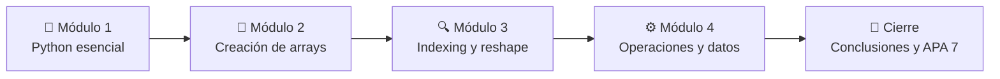

<div align="center">

# 🐍 Práctica N.º 1 · Taller de Python y NumPy

### Fundamentos, estructuras de datos y manejo de arrays

[](https://colab.research.google.com/github/xErnyx/Practica_1_Taller_de_Numpy/blob/main/Practica_1_Taller_de_Numpy.ipynb)


**4 módulos · 16 ejercicios resueltos · explicados paso a paso**

</div>

---

## 👤 Datos académicos

| | |
|---|---|
| 🎓 **Estudiante** | Juan D. Figueroa |
| 🏫 **Universidad** | Universidad Salesiana del Ecuador · Sede Sur |
| 📚 **Carrera** | Ciencias de la Computación |
| 🤖 **Asignatura** | Inteligencia Artificial · 6.º nivel |
| 👨‍🏫 **Docente** | Ing. Rodrigo Tufiño |
| 📅 **Fecha** | Octubre de 2026 |

---

## 📖 ¿De qué trata este proyecto?

Esta práctica nivela el manejo de **Python** y de la librería **NumPy**, base del cálculo numérico en ciencia de datos e inteligencia artificial. Cada módulo combina:

- 📐 **Teoría:** ejemplos del taller con su fundamento conceptual.
- ✏️ **Práctica:** ejercicios resueltos con código comentado y salidas visibles.
- ✅ **Cierre:** introducción, objetivos, conclusiones, recomendaciones y referencias en **APA 7.ª edición**.

> [!TIP]
> Haz clic en el botón **Open in Colab** de arriba para ejecutar el notebook directamente en tu navegador. No necesitas instalar nada.

---

## 🗺️ Ruta de aprendizaje



---

## 🧩 Contenido por módulos

### 🐍 Módulo 1 · Python esencial

Repaso de las estructuras nativas que NumPy extiende y complementa.

| Ejercicio | Qué se resolvió | Concepto clave |
|:---:|---|---|
| 1 | Múltiplos de 7 entre 1 y 100 (**14 valores**) | List comprehension con filtro |
| 2 | Claves con valor > 12 y sus valores al cuadrado: `{'b': 625, 'd': 324}` | Dict comprehension |
| 3 | Función `resumen(lista)` que devuelve un diccionario de estadísticas | Funciones y retorno de diccionarios |
| 4 | Cubos de `[1, 2, 3, 4, 5]` con `map()` | `map` + `lambda` |

### 🧱 Módulo 2 · NumPy: fundamentos y creación de arrays

| Ejercicio | Qué se resolvió | Concepto clave |
|:---:|---|---|
| 1 | Vector 1–20, matriz de ceros 5×3 y 10 puntos con `linspace` | `arange`, `zeros`, `linspace` |
| 2 | Matriz 4×4 aleatoria con `seed(99)`: `shape`, `dtype`, `nbytes` (**128 bytes**) y elemento `[2,3]` | Reproducibilidad y atributos |
| 3 | `int64` vs. `float64` en `np.array([1,2,3])` y `np.array([1.0,2.0,3.0])` | Inferencia de `dtype` |
| 4 | Identidad 5×5 y verificación de su traza (**= 5**) | `np.eye`, `np.trace` |

### 🔍 Módulo 3 · Indexing, slicing y reshape

| Ejercicio | Qué se resolvió | Concepto clave |
|:---:|---|---|
| 1 | Sub-matriz, segunda columna y esquinas de una matriz 5×5 | Slicing y fancy indexing |
| 2 | Máscara `> 12`, reemplazo por `-1` y `np.where` para impares | Máscaras booleanas |
| 3 | Vector de 24 elementos reorganizado en 6×4, 2×3×4 y 1×24 | `reshape` |
| 4 | Demostración de **vista vs. copia** con `np.shares_memory` | Memoria compartida |

### ⚙️ Módulo 4 · Operaciones numéricas y manipulación de datos

| Ejercicio | Qué se resolvió | Concepto clave |
|:---:|---|---|
| 1 | Estadísticas por columna, suma acumulada y **normalización min-max** | `axis`, reducciones |
| 2 | Suma de un vector columna `(3,1)` con un vector fila `(4,)` → resultado `(3,4)` | Broadcasting |
| 3 | Estudiantes con nota sobre el promedio (**3 de 6**) | Máscaras y conteo con `sum()` |
| 4 | Concatenación vertical `(6,4)` y horizontal `(3,8)`, y división con `vsplit` | `concatenate`, `vsplit` |

---

## 💡 Conceptos clave que se aprendieron

<details>
<summary><b>🧠 Vista vs. copia</b> (clic para expandir)</summary>

<br>

El **slicing** devuelve una *vista* que comparte memoria con el array original, así que modificarla altera el original. La **indexación booleana**, el **fancy indexing** y `.copy()` generan copias independientes.

```python
vista = A[0, :]
vista[0] = 999
print(np.shares_memory(A, vista))   # True → A también cambió
```

</details>

<details>
<summary><b>📡 Broadcasting</b> (clic para expandir)</summary>

<br>

Permite operar arrays de distinta forma sin copiar datos. Las shapes se comparan de derecha a izquierda y las dimensiones de tamaño 1 se "estiran".

```python
columna = np.array([[10], [20], [30]])   # (3, 1)
fila    = np.array([1, 2, 3, 4])         # (4,) → (1, 4)
print((columna + fila).shape)            # (3, 4)
```

</details>

<details>
<summary><b>📉 Reducciones y el parámetro <code>axis</code></b> (clic para expandir)</summary>

<br>

`axis=0` opera por **columna** y `axis=1` opera por **fila**. Se aplicó en la normalización min-max:

```python
norm = (X - X.min(axis=0)) / (X.max(axis=0) - X.min(axis=0))
```

</details>

---

## 🚀 Cómo ejecutarlo

**Opción 1 · En Google Colab (recomendada)**
1. Haz clic en el botón **Open in Colab** al inicio de este README.
2. Ejecuta todo con **Entorno de ejecución → Ejecutar todas**.

**Opción 2 · En local**

```bash
git clone https://github.com/xErnyx/Practica_1_Taller_de_Numpy.git
cd Practica_1_Taller_de_Numpy
pip install numpy jupyter
jupyter notebook Practica_1_Taller_de_Numpy.ipynb
```

---

## 📂 Estructura del repositorio

```text
📦 Practica_1_Taller_de_Numpy
 ┣ 📓 Practica_1_Taller_de_Numpy.ipynb   ← notebook con módulos y ejercicios
 ┣ 📄 README.md                          ← descripción del proyecto
 ┗ 📄 LICENSE                            ← licencia MIT
```

---

## 🛠️ Tecnologías

| Herramienta | Uso |
|---|---|
| **Python 3** | Lenguaje de programación |
| **NumPy** | Cálculo numérico con arrays N-dimensionales |
| **Google Colab** | Entorno de ejecución en la nube |
| **Jupyter Notebook** | Formato del documento (`.ipynb`) |

---

## 📚 Referencias (APA 7.ª edición)

- Google. (s. f.). *Colaboratory: Preguntas frecuentes*. https://research.google.com/colaboratory/faq.html
- NumPy Developers. (s. f.). *NumPy user guide*. https://numpy.org/doc/stable/user/index.html
- Python Software Foundation. (s. f.). *Python 3 documentation*. https://docs.python.org/3/
- Tufiño, R. (2026). *Taller de nivelación: Python y NumPy. Fundamentos, estructuras de datos y manejo de arrays* [Material de clase, 6.º nivel]. Universidad Salesiana del Ecuador.
- VanderPlas, J. (2016). *Python data science handbook: Essential tools for working with data*. O'Reilly Media.

---

<div align="center">

Hecho con 💙 por **Juan D. Figueroa** · [@xErnyx](https://github.com/xErnyx)

⭐ Si te sirvió este repositorio, ¡déjale una estrella!

</div>
